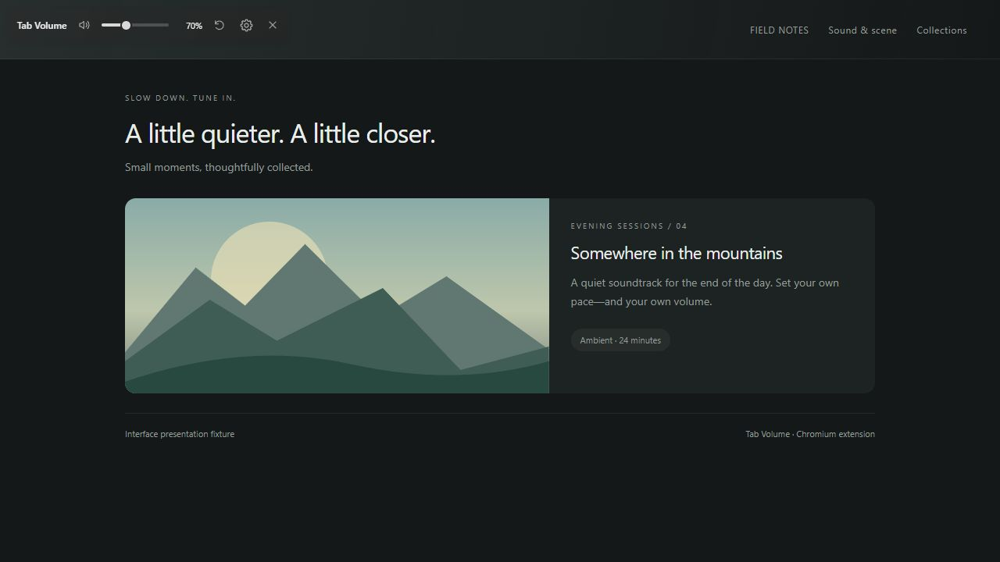
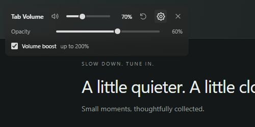
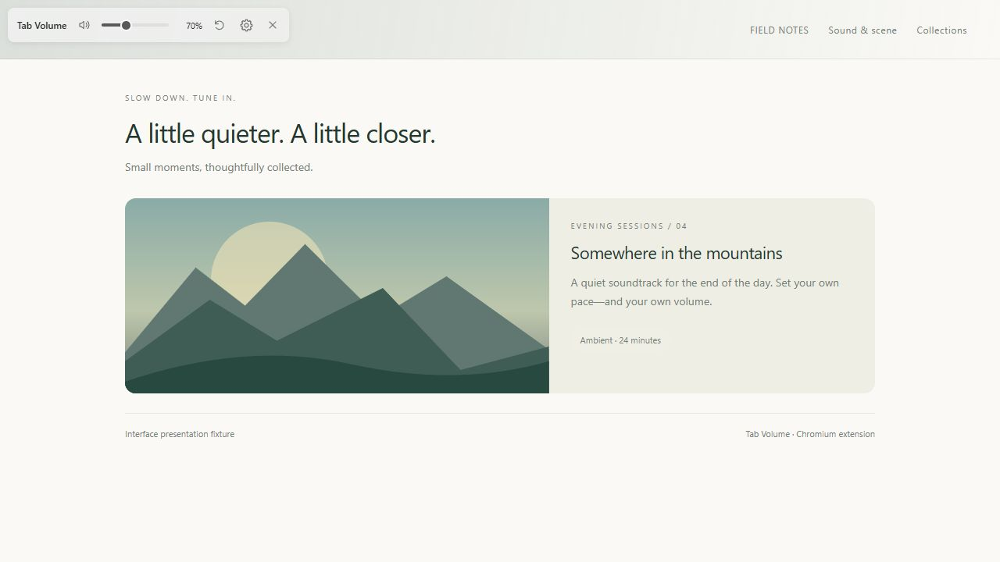

# 'Looks-Like-It's-Native' Tab Volume -- Chromium Extension

**Chrome volume control that feels at home in your browser.** A small, translucent banner gives each tab its own volume slider—without a separate popup window.

Built for Helium and recent Chromium browsers. Tested by the author in **Helium and Chrome**. Requires **Chromium 150 or newer**.



## Where is the Tab Volume button?

**Right-click the browser tab at the very top of your window, then click `Tab Volume`.**

Right-click the tab's title—the one beside its close **X**. Right-clicking the video or the webpage opens a different menu.

The banner appears in the **top-left of the webpage, below the browser toolbar**. Choose **Tab Volume** again to hide it. You can also pin the extension and click its toolbar icon to toggle it for the current tab.

## Install

1. Click the green **Code** button on this repository and choose **Download ZIP**.
2. Extract it to a permanent folder.
3. Open `chrome://extensions` in Chrome or `helium://extensions` in Helium.
4. Turn on **Developer mode**.
5. Click **Load unpacked** and select the **`tab-volume` folder inside the extracted repository**. It contains `manifest.json`.
6. Play audio in a website tab. **Right-click that browser tab → Tab Volume**.

Keep the extracted folder in place: the browser loads the extension from it. This is a manual installation, not a Chrome Web Store listing.

## A small banner. A few useful controls.

| Control | What it does |
| --- | --- |
| Volume slider | Adjust this tab from 0–100% of its original audio output. |
| Speaker | Mute; click again to restore your last nonzero level. |
| Reset arrow | Silently restore original audio and release volume control. Reopen Tab Volume to reconnect. |
| Settings gear | Show opacity and volume boost settings. |
| X | Hide the banner while keeping your volume applied. |

Each tab has its own level. Switching tabs doesn't change which tab a banner controls.

## Make it yours



**Opacity:** move the slider to make the banner more or less transparent. The text and controls stay opaque.

**Volume boost:** turn it on to extend the main slider to **200%**. Turning it off brings any connected tabs above 100% back to 100%.

Opacity and boost preferences are saved locally and shared across tabs. The banner follows system light/dark mode; automatic matching to custom browser themes is a possible future improvement.



*Screenshots show the actual banner code rendered on a neutral demo page; the page is a presentation fixture, not a shipped website or browser theme.*

## Keyboard controls

Focus the volume slider and use **arrow keys** for exact 1% steps; **Home** and **End** go to its limits. **Escape** hides the banner when focus is inside its controls.

## Privacy

Audio stays on your device. Tab Volume routes tab audio through a local Web Audio gain node; it **doesn't record audio, send it to a server, or include analytics**. Opacity and boost preferences are stored locally.

It runs on a website only when invoked. It doesn't request access to every website. The permissions are:

| Permission | Purpose |
| --- | --- |
| `contextMenus` | Add **Tab Volume** to the browser tab's right-click menu. |
| `activeTab` | Temporarily access the tab after you invoke the extension. |
| `scripting` | Place the banner inside that webpage. |
| `tabCapture` | Obtain the tab's audio for local volume adjustment. |
| `offscreen` | Keep the audio adjustment running when the banner is hidden. |
| `storage` | Remember opacity and boost preferences. |

The browser may show an audio capture/sharing indicator while the extension controls a tab. See [PRIVACY.md](PRIVACY.md) for details.

## Good to know

- Browser settings pages, extension-store pages, and other restricted pages can't display the banner. If injection is blocked, the extension's toolbar badge shows **!**.
- If capture fails on a background tab, select that tab, then hide and reopen **Tab Volume**. Protected media or another audio extension can prevent capture.
- A tab muted through the browser must be unmuted there before you'll hear it.
- A full page navigation removes the banner, but audio capture can continue. Invoke **Tab Volume** again to bring the banner back.
- Volume levels reset when the tab closes, the browser restarts, or the extension reloads. Appearance and boost preferences persist.
- Boost means signal amplification; 200% isn't a promise of twice the perceived loudness. Loud source audio may distort above 100%.
- The banner overlays a small part of the page; it doesn't resize tabs or shift the site's layout.
- Incognito is currently disabled.

## Updating a manual installation

Replace the files in your installed `tab-volume` folder, click **Reload** on its extension card, and refresh the website tabs you used it on. Audio levels reset during the reload; saved settings remain.

## Development

The extension uses plain JavaScript, Manifest V3, and a closed shadow root for style isolation. No build step or third-party runtime dependencies are required.

```sh
npm test
```

The Node tests use mocked browser and audio APIs. They cover independent tab volumes, boost limits, reset, cleanup, menu targeting, and saved settings. They complement manual browser testing; they don't simulate actual audio playback.

Bug reports are welcome: include your browser version, operating system, the affected website, and steps to reproduce. Avoid posting private browsing details or recordings.

**Search terms:** Chrome volume, Chrome volume control, Chromium volume extension, per-tab volume, tab audio, volume booster, Helium extension.
